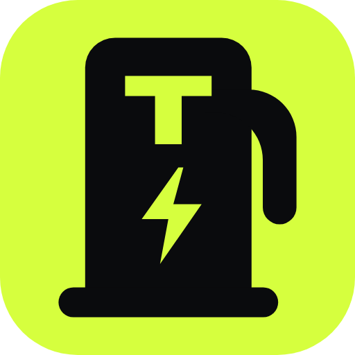

# Tesla Wraps

Browse, preview, and download wraps for Tesla Paint Shop.

[Visit Tesla Wraps](https://tesla-wraps.net/)

## Disclosure and purpose

This repository is the official public directory for Tesla Wraps. It introduces the independent fan gallery and links to live pages; it is not an independent review. Application source is not published here. A public GitHub listing here does not guarantee search-engine indexing, ranking, or backlink value.

## What it does

Choose the exact model, year, and trim because layouts differ. Gallery files are checked against the matching official template. Preview wraps in real-time 3D, then download a Paint Shop PNG and import it through the Tesla app or a USB drive. Browsing, previewing, and downloading gallery wraps require no account, email, or upload.

## How to use and key pages

| Page | What you can do |
| --- | --- |
| [Gallery](https://tesla-wraps.net/gallery) | Browse wraps by model. Supported models include Model 3 (2017–2023, 2024+, and 2024+ Performance), Model Y (2020–2024, 2025+ Premium, Standard, and Performance, and Model Y L), Model S (2021+ and 2025+ Plaid), Model X (2021+), and Cybertruck. |
| [Import guide](https://tesla-wraps.net/guide) | Use a PNG only; JPG and WebP are skipped. Images must be 512–1024 px per side and under 1 MB. Most cars use a square canvas; Cybertruck uses 1024×768. For the Tesla app (4.59.0+), download the PNG to your phone, then open Creations → Wrap → Upload. In the car, open Toybox → Paint Shop → Wraps when online; up to 10 wraps can be added by app. For USB, use exFAT, FAT32, MS-DOS FAT, ext3, or ext4 (not NTFS), create a top-level `Wraps` folder, copy up to 10 PNG files directly into it, and connect to a USB data port. Then open Toybox → Paint Shop → Wraps. |
| [Photo preview](https://tesla-wraps.net/photo) | Preview your own photo on the exact Tesla in your browser. Nothing is uploaded. Adjust and export a watermark-free Paint Shop PNG masked to that model's official layout, with no account required. |
| [AI wrap pricing](https://tesla-wraps.net/pricing) | See current details for optional one-time credit packs. |

## Limits and disclaimer

Site wraps are prepared for the stated file rules. Home page files are typically 1024×1024 and under 1 MB, with filenames of 30 characters or fewer.

Independent fan project. Not affiliated with or endorsed by Tesla, Inc. Paint Shop wraps change the on-screen car only; your real paint stays as it is.

## Links

- Website: [tesla-wraps.net](https://tesla-wraps.net/)
- Contact: [hello@tesla-wraps.net](mailto:hello@tesla-wraps.net)
- Refund policy: [site policy](https://tesla-wraps.net/refund-policy)

## License

Documentation text in this repository is licensed under [CC BY 4.0](LICENSE). This license does not cover the website content, application source, or trademarks.
